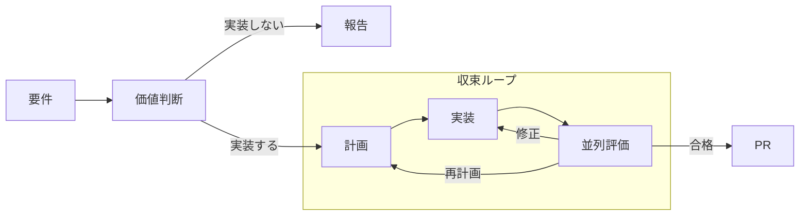

# Trinity

Trinity は、要件を渡すと計画・実装・評価を繰り返して Pull Request に仕上げる、長時間タスク向けの Claude Code プラグインである。すでにある PR やブランチに、評価だけ、または評価に基づく修正だけを当てることもできる。導入するだけで設定なしに使える。あなたがすることは2つだけで、最初に設計の確認へ答えることと、最後にどの PR を受け入れるかを選ぶことである。その間は人手なしで走り切る。

## 導入

Claude Code で次を実行する。

```shell
/plugin marketplace add yjn279/trinity
/plugin install trinity@yjn279
```

`git` が PATH にあること。依存する [git-flow スキル](https://github.com/yjn279/.claude/tree/main/skills/git-flow)と [product-management スキル](https://github.com/yjn279/.claude/tree/main/skills/product-management)は、未導入でも起動時に自動でセットアップされる（`~/.claude` への変更を含む）。

人手なしで走り切るには、確認を挟まない権限モード（auto など）で Claude Code を起動する。サブエージェントは起動元の会話の権限モードを引き継ぐ。

## 使い方

要件は自由形式の文でも Issue 番号でもよい。

```shell
/trinity:run ユーザー設定ページにテーマトグルを追加する。
/trinity:run #12 #15 #20
```

すでにある PR やブランチには、次の2つのコマンドを使う。対象は PR 番号またはブランチ名で、省略すると現在のブランチになる。文を添えると追加の要件になる。

```shell
/trinity:review #30
/trinity:fix #30
```

`/trinity:review` は、PR の本文と紐づく Issue を要件として、コードに触れずに評価だけを行い、判定と指摘を報告する。`/trinity:fix` は、最新の評価に基づいて修正し、PR へ反映する。再評価は `/trinity:review` を再度実行する。評価が無いときは、先に `/trinity:review` を実行する。2つのコマンドは1回に1段だけ行い、評価の上限（5つ）は掛からない。同じブランチなら `/trinity:run` を含めて作業の記録を共有するので、続けて使える。

起動すると、作業単位ごとにブランチと作業用の複製フォルダ（worktree）を切り、1本ずつ直列に処理して独立した PR を作る。使用量上限や障害で途中停止しても、再度起動すれば完了済みの工程を飛ばして続きから再開する。仕上がった PR はマージ候補として提示され、マージされた作業単位の環境は自動で片付く。選ばなかった PR は環境ごと残るほか、修正要望を添えてその場で作り直させることもできる。

## 仕組み

計画・実装・評価を1つの文脈に同居させると、文脈が膨らむほど計画が実装の都合で書き換わり、評価者が自分の作品に甘くなる。Trinity は役割を分けることでこの失敗を防ぐ。

役割は3つである。Orchestrator は `/trinity:run` を受け取ったメイン会話の Claude 自身で、Generator と Evaluator を固有の指示と新鮮な文脈を持つサブエージェントとして起動する。Orchestrator は計画するがコードは書かない。Evaluator は書き込み系ツールもサブエージェントを起動する手段も持たず、差分も検証も自分で再導出する。状態はすべて `RUN_DIR` のファイルに置く。

| 役割 | モデル | 担当 |
| :-- | :-- | :-- |
| Orchestrator | メイン会話 | 要件の解釈・取り組む価値の判断・計画（評価観点を含む）・設計の確定・サブエージェントの起動と判定の集約・再計画・PR 作成・受け入れ確認・後片付け |
| Generator | sonnet | 計画のタスクを worktree の中で実装し、検証を通してコミットする。最後の Generator はブランチ全体の差分にツール（`/code-review --fix`・`/simplify`・`/markdown`）もかける |
| Evaluator | sonnet | 割り当てられた1つの評価観点で、デフォルトブランチとのブランチ全体の差分を独立に判定する |

## 流れ

作業単位ごとに、Orchestrator が取り組む価値を判断してから収束ループを直接回す。実装しないと決めたら変更案の報告で終わり、実装するなら計画へ進む。評価は観点ごとに並列で行う。



判定は3値で、最も厳しいものを採る。

| 判定 | 動作 |
| :-- | :-- |
| `PASS` | すべての観点を満たす。ループを離脱して PR 作成へ進む |
| `NEEDS_REVISION` | 計画・要件が誤っている。Orchestrator がユーザーに問わず再計画する |
| `FAIL` | 計画は妥当。既存計画の範囲内で Generator が修正する |

## 仕様

確定している仕様を以下に示す。ここに無いものは実装の裁量である。

| 仕様 | 内容 |
| :-- | :-- |
| 処理フロー | Orchestrator が計画し、Generator と Evaluator をサブエージェントとして起動して、1つの収束ループを回す。いまの要件に対する評価が5つに達しても合格しない作業単位は止める |
| 取り組む価値の判断 | 計画の段で `product-management` スキルを適用し、既存機能の活用・設定・運用・ドキュメント・原因となる機能の削除といった実装しない解決や、複数の課題をまとめて解く根本対応を検討して、「実装しない／根本対応に組み替える／要求どおり実装する」を判断する。実装しないなら変更案を報告して終える。ユーザーの判断が要るときは、最初の設計確認に含める |
| 評価観点 | 常設の「要件適合」（受け入れ基準を満たすか）と「価値」（変更の価値を利用者視点の1文で説明できるか、要素や分岐が増えていないか、要件や計画そのものが正しいか）に、実装対象に応じた観点（安全性・アクセシビリティ・見た目・性能・互換性・文書の整合・デザインの美・コードの美など）を加える。各観点には PASS / FAIL で判定できる基準を添える。観点は計画ごとに固定し、変わるのは再計画のときだけ。観点ごとに Evaluator を1体ずつ並列に起動し、最も厳しい判定を採る |
| worktree 実行 | 作業は `git-flow` スキルで切り出した worktree の中で行う。複数の作業単位は直列に実行する |
| 確認 | 設計は起動時に Orchestrator が `AskUserQuestion` で確定する。実行中はユーザーに確認しない |
| サブエージェント起動 | Generator はタスクごとに直列に、Evaluator は観点ごとに並列に起動する。役割の制限はエージェント定義のツール指定で表し、Evaluator は書き込み系ツールもサブエージェントを起動する手段も持たない。`/code-review --fix`・`/simplify`・`/markdown` は、各周で最後に起動される Generator（計画の最終タスクと修正）だけが、デフォルトブランチとのブランチ全体の差分にかけ、計画に反する修正は採らない |
| 柔軟性 | 複数 Issue・単発 Issue・Issue でないタスク・実施後の修正のいずれにも対応する |
| 既存の PR・ブランチ | `/trinity:review` と `/trinity:fix` は、そのブランチを worktree に切り出し、PR の本文・紐づく Issue・起動時の文を要件とする。作業の記録（`RUN_DIR`）は `backlog.tsv` の `branch` 列から引いて再利用する。`/trinity:review` は評価だけを `eval-<k+1>.md` に保存し、`/trinity:fix` は最新の評価に対する修正を `gen-<k+1>-revise.md` に書いて PR へ反映する。その評価に対する修正が済んでいれば飛ばす。`/trinity:run` も同じ扱いで既存のブランチを対象にできる |
| PR マージ | Git Issue が提示された場合は Issue ごとに独立した PR を作成し、`AskUserQuestion` で提示した候補のうちユーザーが選択したものをマージする |
| 課題起票 | 対象リポジトリと Trinity 本体それぞれの改善課題を `AskUserQuestion` で起票提案し、選択された課題を Issue として登録する |
| 再開 | 各段は、その出力ファイルが既にあれば飛ばす。中断（使用量上限・レートリミット・障害など）後は再度起動すれば、ファイルから到達点を読み取って続きから再開する。要件より新しい評価だけをいまの要件に対する評価とみなす。合格は、最新の評価が `PASS` で、評価したコミットが worktree の `HEAD` と同じで、その評価が要件より新しいときに限る |
| 後片付け | マージと課題起票の完了後、マージされた作業単位の環境（ブランチ・worktree・実行時に生成されたファイル）をリモートを含めて削除する。マージされなかった単位はすべて残す |

## 開発

規約とファイル構成は [CLAUDE.md](CLAUDE.md) を参照する。

## 参考

- Anthropic「Harness design for long-running apps」 https://www.anthropic.com/engineering/harness-design-long-running-apps
- Qiita「@nogataka 氏の解説記事」 https://qiita.com/nogataka/items/efe8eb9df612d2211221
